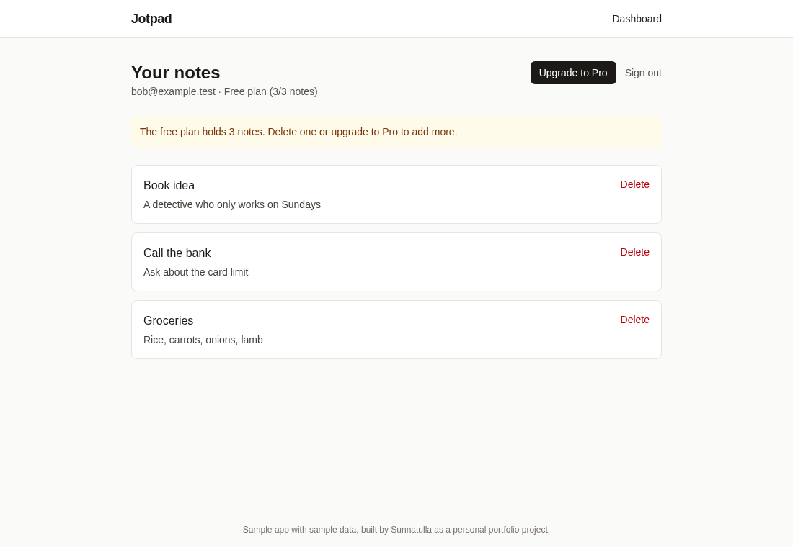
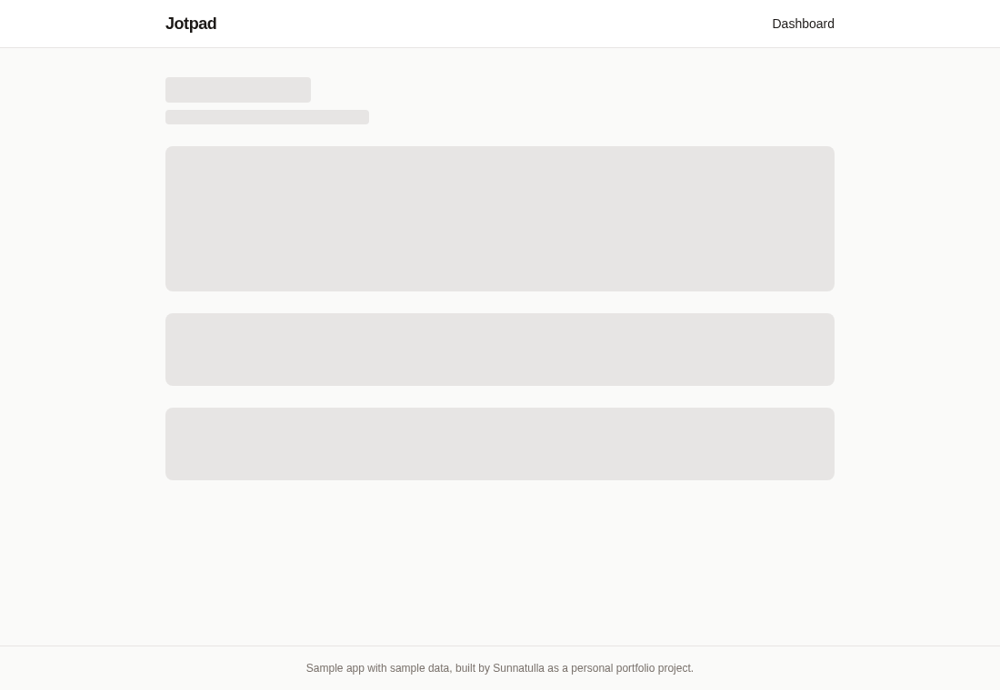
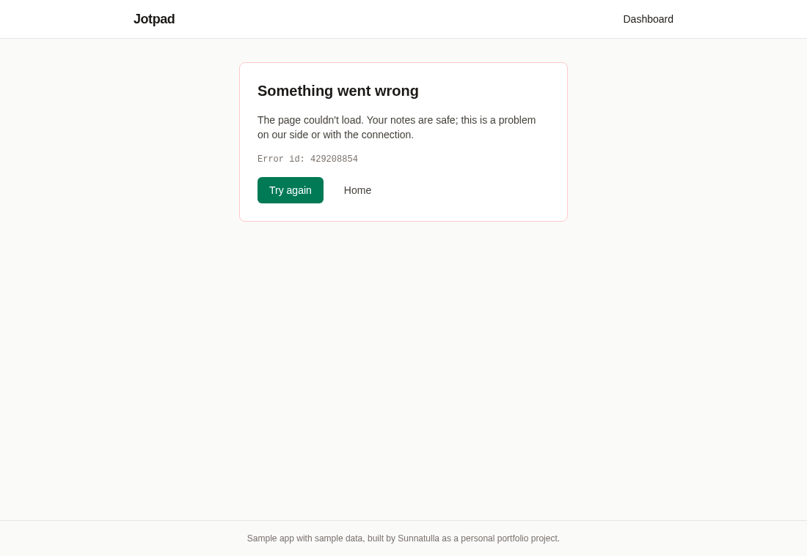
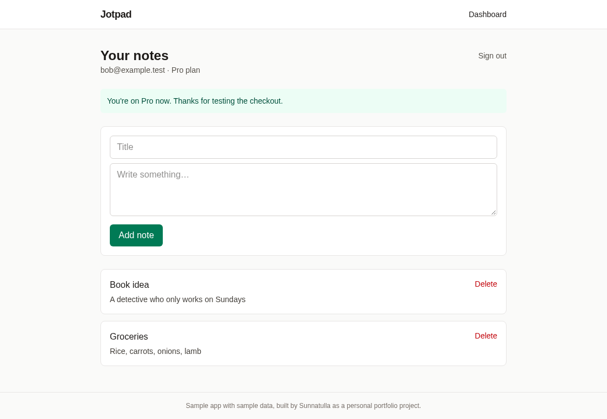

# Jotpad: rescuing a vibe-coded Next.js + Supabase + Stripe app

A personal portfolio project by Sunnatulla. Jotpad is a small notes app (free plan: 3 notes, Pro via Stripe
test mode). I wrote it on purpose with the bugs AI-generated MVPs usually ship with, then fixed them one commit
at a time, with a test for each fix.

All data in the app, the tests and the screenshots is sample data. Nothing here is client code.



The broken version is tagged `v0-broken`. [BUGS.md](BUGS.md) has the long version of every bug (symptom, cause,
reproduction, fix). This page is the short version.

```bash
git log --oneline v0-broken..main   # the rescue, commit by commit
git diff v0-broken main -- supabase # e.g. just the database side
npm run e2e:before                  # watch the bugs reproduce on v0-broken
npm run e2e                         # the fixed app in a real browser
```

## What was wrong and how it was fixed

| #   | Bug                                                          | Fixed in |
| --- | ------------------------------------------------------------ | -------- |
| 1   | Auth redirect loop on `/login`                               | Fix 1    |
| 2   | RLS policies that let every user read every note             | Fix 2    |
| 3   | Stripe webhook that was never reached and trusted any caller | Fix 3    |
| 4   | Missing env vars: cryptic build crash or a blank page        | Fix 4    |
| 5   | No loading, empty or error states                            | Fix 5    |
| 6   | Paywall that only existed in the UI                          | Fix 6    |

This is the output of `npm run e2e:before`. It builds `v0-broken`, runs it against the same local database and
makes the requests a browser, Stripe or a curious user would:

```
# Bug 1: redirect loop
GET /login (signed out)                    → 307 Location: /login
GET / (signed out)                         → 307 Location: /login

# Bug 2: RLS lets everyone read and write everything
anon key, select notes                     → [{"title":"Alice's sample note"}]
Bob inserts a note owned by Alice          → 201

# Bug 3: the webhook never runs and trusts anyone
POST /api/stripe/webhook, no signature     → 307 Location: /login

# Bug 6: the paywall is only in the UI
Bob sets his own plan to "pro"             → [{"plan":"pro"}]
```

### 1. Redirect loop on /login

The proxy sent every signed-out request to `/login`, including `/login` itself. The only exception was paths
under `/auth`.

```ts
// before: src/proxy.ts
if (!user && !request.nextUrl.pathname.startsWith("/auth")) {
  return NextResponse.redirect(new URL("/login", request.url));
}
```

After: an explicit list of protected routes (`/dashboard`), signed-in users get sent from `/login` to the
dashboard, refreshed session cookies are copied onto redirects, and `?next=` only accepts paths on this site so
it can't be used as an open redirect. Tests: `tests/proxy.test.ts`, `tests/safe-next-path.test.ts`.

### 2. RLS that protects nothing

RLS was on, but the notes policies were the dashboard templates, and the page query had no `user_id` filter
because it relied on RLS.

```sql
-- before
create policy "Enable read access for all users" on public.notes for select using (true);
create policy "Enable insert for authenticated users only" on public.notes for insert with check (true);
```

After: a migration that ties every operation to the owner, scoped `to authenticated`, plus an index for the
dashboard query.

```sql
create policy "Users can read own notes" on public.notes for select
  to authenticated using ((select auth.uid()) = user_id);
```

Tests: `tests/rls.test.ts` runs the real migrations in an in-process Postgres with Supabase's roles.

### 3. The Stripe webhook

Three problems on top of each other: the proxy redirected Stripe to `/login`, the handler parsed the body
without checking the signature, and it wrote with the cookie-based client, so the update ran as `anon`, matched
0 rows and still answered 200.

```ts
// before
const event = JSON.parse(body); // "In production you should verify the Stripe signature here."
```

After: the webhook is out of the proxy matcher, `stripe.webhooks.constructEvent` checks the raw body (400 on a
bad or missing signature), the plan is set with a server-only service-role client, and a failed or 0-row
update answers 500 so Stripe retries. Only a paid `checkout.session.completed` upgrades anyone.
Tests: `tests/webhook.test.ts` signs events with Stripe's own `generateTestHeaderString`.

### 4. Missing env vars on deploy

`process.env.X!` everywhere and a Stripe client created at import time. A deploy without the variables died
while prerendering with a library error that named none of them, and a bad value at runtime gave a white page.

After: `src/lib/env.ts` validates everything in one place and names what's missing, `next.config.ts` runs that
check at the start of a production build, Stripe is created on first use, and there are `error.tsx`,
`global-error.tsx` and `not-found.tsx`. A deploy without the variables still fails, but in the first second and
with the list:

```
Missing environment variables: NEXT_PUBLIC_SUPABASE_URL, NEXT_PUBLIC_SUPABASE_ANON_KEY, ...
NEXT_PUBLIC_ values are inlined at build time, so redeploy after adding them.
```

Tests: `tests/env.test.ts`.

### 5. No loading, empty or error states

`const { data } = await supabase...` with the error ignored, so a failed query showed "No notes yet." Buttons
had no pending state (double click, two notes), a failed insert cleared the form anyway, and the upgrade button
navigated to `undefined` when checkout failed.

After: the dashboard throws on query errors and `error.tsx` shows a retry, `loading.tsx` shows a skeleton, add
and delete are server actions with validation, pending buttons and inline errors, and the form clears only
after a save. Tests: `tests/actions.test.ts`, `tests/checkout.test.ts`.

| Slow database                                                 | Database down                                     |
| ------------------------------------------------------------- | ------------------------------------------------- |
|  |  |

### 6. A paywall in the UI only

The "update own profile" policy covered every column, `plan` included, and the 3-note limit was an `if` in the
React form.

After: no update policy on `profiles` (only the webhook's service role changes `plan`), and the insert policy
calls a `security definer` function `can_add_note()` that checks the plan and count under a per-user advisory
lock. Tests: `tests/rls.test.ts`.



### Found later by the browser run

The E2E run caught two more bugs after the six fixes were done:

- "Try again" on the error page called `reset()`, which re-renders the same failed server result. It now calls
  `retry()`, which fetches the page again.
- Sign-out redirected with `new URL("/login", request.url)`. Behind `next start` that URL has the server's own
  hostname, so the browser could land on another origin without its cookies. The auth routes now redirect with
  a relative `Location` (`tests/auth-routes.test.ts`).

## Stack

- Next.js 16 (App Router, `src/proxy.ts`), React 19, TypeScript, Tailwind CSS 4
- Supabase: Auth (email + password) and Postgres with Row Level Security, via `@supabase/ssr`
- Stripe Checkout and webhooks (test mode)
- Vitest for unit, route and database tests; the database tests run the real migrations in
  [PGlite](https://pglite.dev) with a small shim for Supabase's roles and `auth.uid()`
- Playwright (`playwright-core`) driving Chrome for the end-to-end run

## Run it

```bash
npm install
cp .env.example .env.local   # your Supabase project and Stripe test keys
# apply supabase/migrations/*.sql in order in the Supabase SQL editor (or `supabase db push`)
npm run dev

# Stripe webhooks locally (Stripe CLI): copy the printed whsec_... into STRIPE_WEBHOOK_SECRET
stripe listen --forward-to localhost:3000/api/stripe/webhook
```

Checks:

```bash
npm test               # unit, route and database tests
npm run lint
npm run typecheck
npm run format:check
npm run build          # stops with a list of missing env vars if any are unset (bug 4)
npm run e2e            # build + browser run against a local Supabase stand-in, saves docs/screenshots/
npm run e2e:before     # the bug transcript above, from v0-broken
```

`npm run e2e` needs no cloud account. `e2e/local-supabase.mjs` answers the Auth and REST requests this app makes
from PGlite with the real migrations applied, so RLS, the signup trigger and the paywall function run as
they do in Supabase. It covers only what Jotpad uses and is never part of the app. The upgrade is driven by a
webhook event signed with a test secret, the same thing `stripe trigger` sends; Stripe itself isn't called.
Set `CHROME_PATH` if Chrome isn't at `/usr/bin/google-chrome`.

## Project layout

```
src/proxy.ts                         route protection + Supabase session refresh
src/lib/env.ts                       env var validation (names what's missing)
src/lib/supabase/                    browser, server and service-role (server-only) clients
src/app/login/                       sign in / sign up
src/app/dashboard/                   notes page, loading skeleton, server actions for add / delete
src/app/api/checkout/route.ts        creates a Stripe Checkout session
src/app/api/stripe/webhook/route.ts  verifies the signature, marks the user as Pro after payment
supabase/migrations/                 schema, RLS policies, server-side paywall
tests/                               proxy, env, actions, auth routes, checkout, webhook and RLS tests
e2e/                                 local Supabase stand-in, browser run, v0-broken transcript
```

## License

MIT
